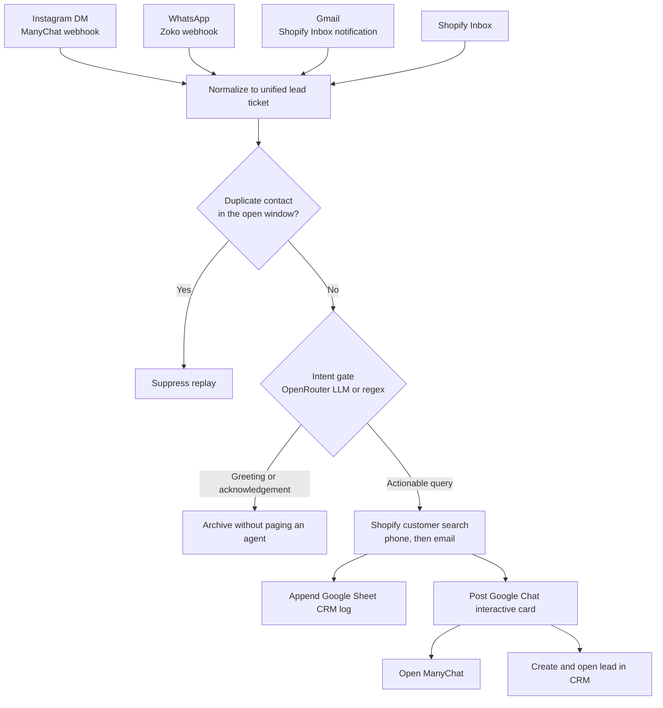

# Omnichannel Support Triage & High-Conversion Lead Ingestion Engine

## Executive Summary

Instagram DMs were the highest-intent inbound channel and the one most likely to die in the inbox. Unhandled Instagram inquiries were dropping off at about **80%** before an agent ever replied. The same customers were also writing through Gmail, Zoko WhatsApp, and Shopify Chat, so the team was watching four queues and answering whichever one they happened to have open.

This engine collapses those transports into one lead ticket. A message is ingested, classified, matched to a Shopify customer when a phone or email exists, written to a Google Sheet CRM log, and pushed to Google Chat as a card with two actions: open the conversation in ManyChat, or create the lead in the CRM and land on it. Agents work one alert stream. Social traffic that used to age out in ManyChat now reaches a person while the buyer is still in the thread.

The repository is the portable core of that system: a strict ticket schema, realistic channel payloads, the Shopify Inbox email parser, and a simulator that runs the full path locally. Production wiring (Pabbly, OpenRouter, ManyChat, Zoko, Google Chat, Google Sheets) is documented in the workflow section and in `docs/`.

## Architecture Diagram



Every channel is reduced to `schemas/unified_lead_ticket.json` before anything is routed. The classifier is the only stage allowed to drop a message. Shopify lookup enriches the ticket and never blocks it: an unknown phone still produces a card, marked as a new contact. The sheet row and the Chat card are the system of record and the page, respectively.

## Production Workflow Architecture

Production is a Pabbly Connect graph in front of the same five stages the simulator runs. OpenRouter performs the intent call. ManyChat and Zoko are the channel edges. Place the matching screenshot in `docs/` and the figures below render.

### Gmail, OpenRouter, and Pabbly

Shopify Inbox and other customer mail arrive in a dedicated Gmail label. Pabbly polls that label, forwards the raw body through the same extraction the local parser does, then asks OpenRouter whether the text is an actionable query and which vertical it belongs to. Non-queries stop here. Actionable mail continues into the Shopify customer search and the shared dispatch steps.


### Zoko WhatsApp webhook

Zoko posts `message.inbound` to a Pabbly webhook. The workflow reads the customer phone and message text, normalizes them onto the unified ticket, and joins the same classifier and Shopify search used by email. Phone match is the usual hit, because WhatsApp already carries an E.164 number.


### Shopify Inbox

Shopify Chat itself is unstructured on the way out: the store receives a notification email, not a clean customer object. The Gmail path above is how that channel enters the engine. The screenshot shows the inbox conversation the agent eventually opens, next to the notification that triggered the pipeline.


### Google Chat alert

The last Pabbly step posts a cards-v2 payload to the care space. The card carries the inquiry, the Shopify match, the assigned agent, and two buttons:

- **Open ManyChat** — deep link to the live chat thread (Instagram) or a contact lookup (WhatsApp and email).
- **Create & Open Lead in CRM** — deep link that creates the lead and opens it, prefilled with the ticket id and contact key.


Instagram is ingested from the ManyChat external request (the live chat URL on that payload is the ManyChat button). All four source channels share the dispatch template, so the care space looks the same regardless of where the buyer wrote.

## Features & Resiliency

- **Normalization.** Instagram, Zoko, Gmail, and Shopify Inbox all emit one ticket. Downstream steps never branch on vendor field names.
- **Intent gate.** Acknowledgements and bare greetings are archived. The Chat space only receives messages an agent can act on, which is what keeps response time short enough to matter on Instagram.
- **Shopify resolution.** Search is phone, then email. A hit attaches `gid://shopify/Customer/…`. A miss still dispatches, with `shopify_customer_id` set to null, so new buyers are not dropped.
- **Deduplication.** A replay of the same channel plus contact key inside the open window is suppressed. In production the idempotency key is the sheet/CRM write; the simulator keeps an in-memory window so the behavior is visible.
- **Deep-link routing.** The agent does not copy a handle into another tool. ManyChat opens the source thread. The CRM button creates the lead and opens it with the ticket id already attached.
- **Vertical routing.** Apparel, beauty, home, and post-purchase each map to an agent or queue on the card, so the page lands with an owner.
- **Parser tolerance.** The Shopify email parser accepts labeled fields, `From: Name <email>` headers, HTML notifications, and missing sender data. It ignores `shopify.com` notification addresses and returns nulls instead of failing the run.

## Quick Start / How to Run the Simulator

Python 3.9 or newer. The simulator and the tests use the standard library only.

```bash
python parsers/pipeline_simulator.py
```

That run ingests the Instagram and WhatsApp mocks, replays the Instagram event to show dedup, drops a Gmail "Thanks!" acknowledgement, and parses the Shopify Inbox notification into a third dispatched lead. Each dispatched lead prints the Google Chat card and the unified ticket. A one-screen CRM log is printed at the end.

Parse a Shopify notification on its own:

```bash
python parsers/shopify_email_parser.py
```

Run the parser tests (unittest, and pytest if you have it installed):

```bash
python -m unittest tests/test_parsers.py
```

| Path | Role |
| --- | --- |
| `schemas/unified_lead_ticket.json` | Strict contract for a dispatched lead |
| `mock_payloads/` | ManyChat, Zoko, and Shopify Inbox fixtures |
| `parsers/shopify_email_parser.py` | Notification email extraction |
| `parsers/pipeline_simulator.py` | End-to-end local run |
| `tests/test_parsers.py` | Valid mail, edge cases, missing sender |
| `docs/` | Production screenshots named in the workflow section |
